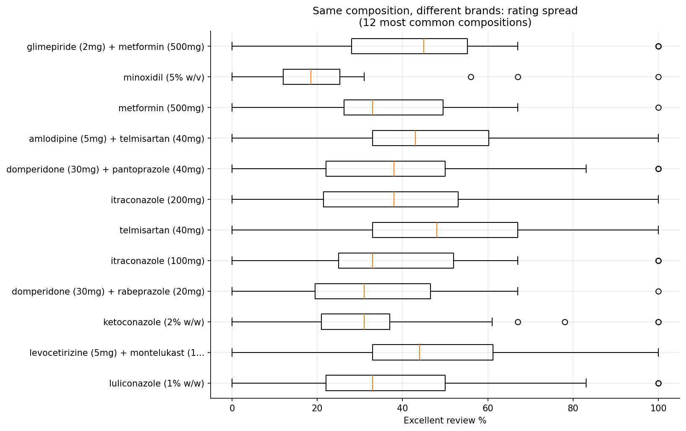
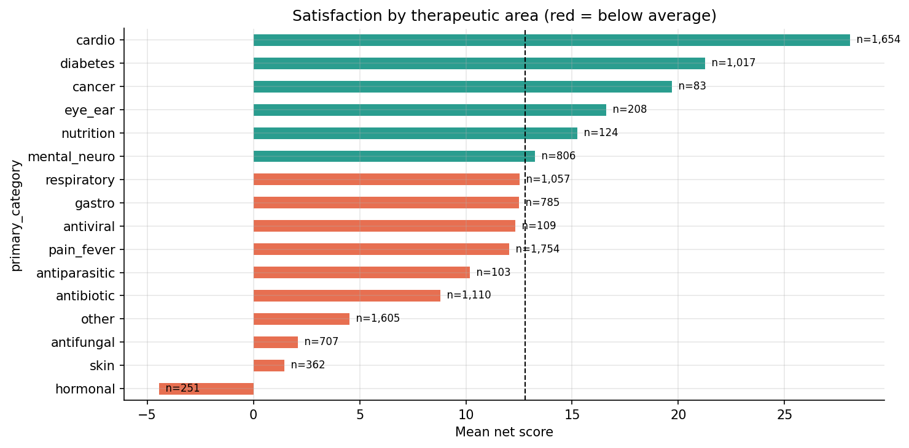
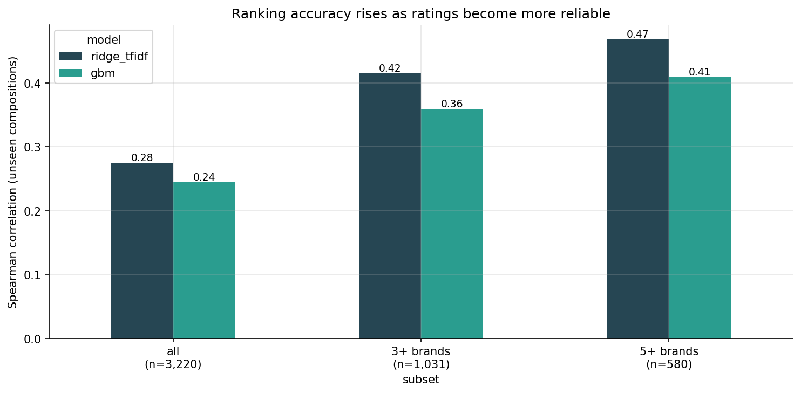
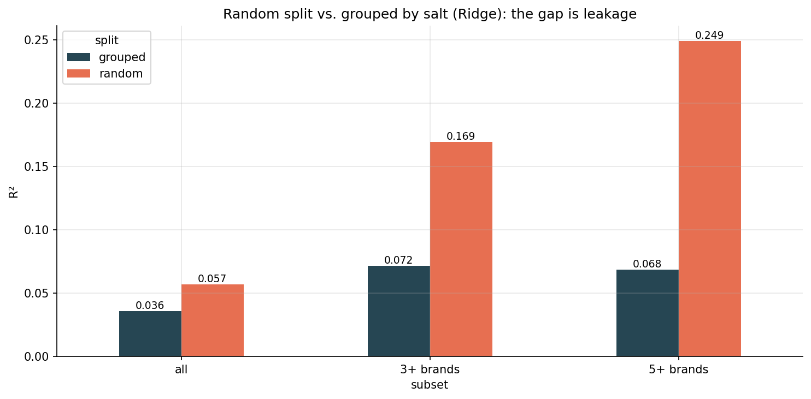
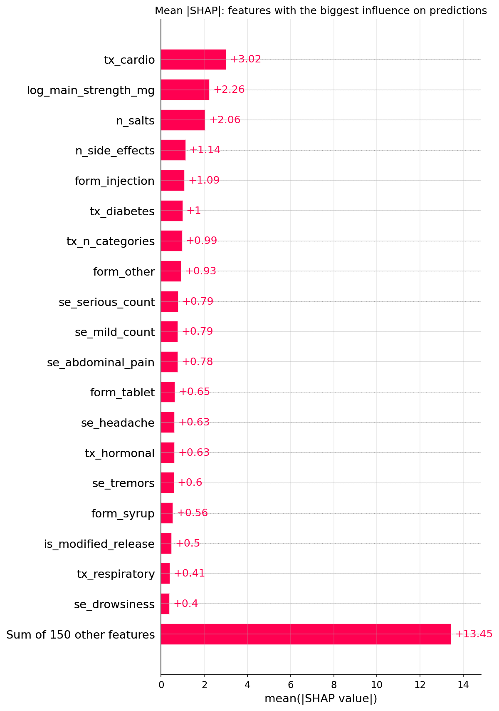
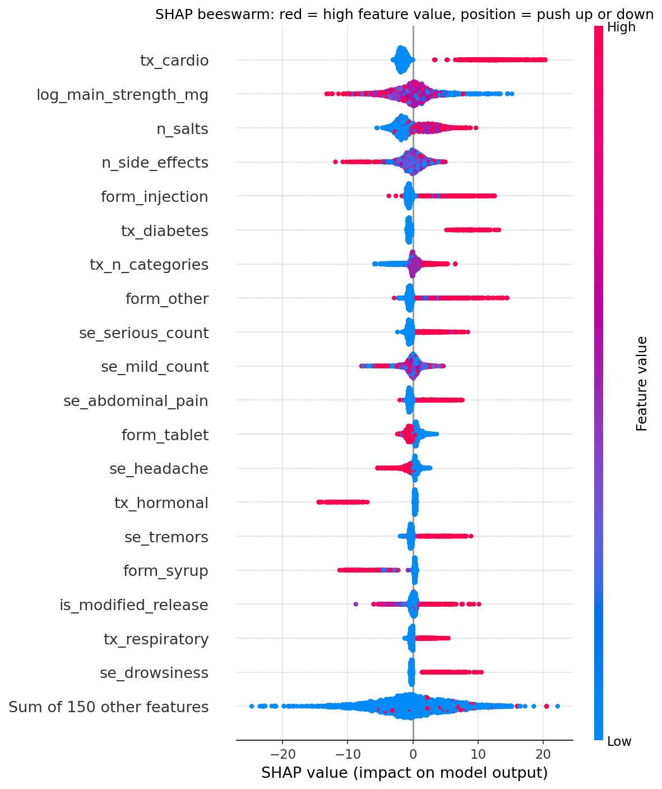

# MedRate India

**What drives patient satisfaction with medicines sold in India?**

An end-to-end machine learning project on 11,735 medicines listed on 1mg, one of India's largest online pharmacies. The project cleans messy pharmaceutical text data, engineers 170 features, tests what actually explains user ratings, and serves the results in an interactive Streamlit app.

**Live app:** [add your Streamlit link here]

---

## Key Findings

1. **The brand matters more than the molecule.** Among compositions sold by 5 or more brands, the exact same salt and strength varies by a median of 67 points in "excellent" ratings across brands. Composition explains only 16.5% of rating variance.

2. **Brand-level ratings are dominated by small-sample noise.** The dataset has no review counts, and 8.4% of medicines have a rating of exactly 100% in one category, a typical sign of very few reviews. Removing these rows improved every model.

3. **Once ratings are averaged across brands, the model ranks unseen medicines meaningfully.** On salt combinations never seen in training, ranking accuracy (Spearman correlation) rises from 0.28 across all compositions to 0.47 for compositions sold by 5 or more brands, whose averaged ratings are more reliable.

4. **Several apparent side-effect effects were confounded by therapeutic area.** In raw data, "ankle swelling" was linked to ratings 23 points higher, and "skin peeling" to 11 points lower. Inside the model, both effects almost disappear: they simply mark cardiovascular drugs (rated highly) and topical creams (rated poorly).

5. **What does drive ratings:**
   - Cardiovascular and diabetes medicines are rated highest; hormonal medicines lowest.
   - Combination drugs rate higher than single-salt drugs; higher strengths tend to rate lower.
   - Syrups and suspensions rate lower; injections rate higher.
   - Side-effect lists show a threshold effect: up to about 15 listed side effects make little difference, while lists longer than about 20 lower predicted satisfaction sharply.

6. **Validation design changed the conclusions.** A naive random split would have reported R-squared of 0.249 on reliable compositions, versus 0.068 with a split grouped by salt combination. The random split lets the model recognise the same molecule at a different strength, overstating performance by about 3.5 times.

---

## Problem Statement

Online pharmacies display user ratings for each medicine. This project asks:

- Can satisfaction be predicted from what a medicine is (its composition, uses, side effects and dosage form)?
- Which factors raise or lower satisfaction once everything else is controlled for?
- How much of the variation in ratings is real signal, and how much is noise?

The target is the **net satisfaction score**: the percentage of "excellent" reviews minus the percentage of "poor" reviews, ranging from -100 to +100.

---

## Data

- **Source:** "11000 Medicine Details" dataset on Kaggle, scraped from 1mg.
- **Size after cleaning:** 11,735 medicines and 3,355 unique compositions.
- **Fields:** medicine name, composition, uses, side effects, manufacturer, and the percentage of excellent, average and poor reviews.

The raw CSV is not included in this repository. To reproduce the project, download `Medicine_Details.csv` from Kaggle and place it in the `data/` folder.

---

## Approach

### 1. Data cleaning (`src/parse.py`)
- Split compositions into individual salts and strengths, converting units to milligrams (for example, "Amoxycillin (500mg) + Clavulanic Acid (125mg)").
- Separated side effects that were run together without delimiters (for example, "Nausea Vomiting Dry mouth").
- Extracted dosage form and modified-release markers (SR, ER, XR) from medicine names.
- Built a canonical composition key so that brands of the same medicine can be grouped.

### 2. Feature engineering (`src/features.py`)
170 features across six groups:

| Group | Examples |
|---|---|
| Numeric | number of salts, side effects and uses; log strength |
| Dosage form | tablet, syrup, injection, cream and others |
| Therapeutic area | 16 categories matched from the uses text with whole-word rules |
| Side-effect severity | counts of serious and mild side effects from a keyword lexicon |
| Common side effects | indicators for the 60 most frequent side effects |
| Common salts | indicators for the 60 most frequent salts |

Manufacturer target encoding is computed inside each cross-validation fold to prevent leakage.

### 3. Modeling (`src/train.py`)
Two levels of analysis:

- **Brand level:** one row per medicine, with cross-validation grouped by composition so that brands of the same medicine never appear in both training and test sets.
- **Composition level (main model):** ratings averaged across all brands of each composition, which cancels much of the per-brand noise. Cross-validation is grouped by salt combination, and compositions sold by more brands receive more weight in training.

Models compared: a mean baseline, Ridge regression on TF-IDF text plus engineered features, and gradient boosting (LightGBM, with an automatic fallback to scikit-learn's HistGradientBoosting).

### 4. Explainability (`notebooks/02_explainability.ipynb`)
- Ridge coefficients for words and features that raise or lower predicted ratings.
- SHAP values for global importance, direction of effects and individual predictions.
- A confounding check comparing each feature's raw gap in the data with its effect inside the model.

---

## Results

### Composition level, unseen salt combinations (main model)

Spearman correlation between predicted and actual ratings:

| Model | All compositions (3,220) | 3+ brands (1,031) | 5+ brands (580) |
|---|---|---|---|
| Baseline (mean) | -0.01 | -0.03 | -0.10 |
| Ridge + TF-IDF | 0.28 | 0.42 | 0.47 |
| Gradient boosting | 0.24 | 0.36 | 0.41 |

Ridge ranks compositions best. Gradient boosting achieves the best weighted R-squared on reliable compositions (0.10) and is used in the app because its predictions can be explained feature by feature with SHAP.

### Brand level, for comparison

| Model | R-squared | Spearman |
|---|---|---|
| Baseline (mean) | 0.000 | -0.02 |
| Ridge + TF-IDF | 0.049 | 0.26 |
| Gradient boosting with manufacturer | 0.024 | 0.23 |
| Gradient boosting without manufacturer | 0.021 | 0.23 |

At brand level, even the manufacturer adds almost no predictive power, which supports the conclusion that much of the brand-to-brand variation is noise from small review counts.

### Confounding check

| Feature | Raw gap in data | Effect inside model (mean absolute SHAP) |
|---|---|---|
| Therapeutic area: cardiovascular | +16.1 | 3.02 (largest of all features) |
| Side effect: ankle swelling | +23.1 | 0.00 |
| Side effect: slow heart rate | +18.0 | 0.15 |
| Side effect: dry skin | -14.0 | 0.33 |
| Side effect: skin peeling | -10.6 | 0.06 |

---

## Visuals

| | |
|---|---|
|  |  |
| Rating spread across brands of the same composition | Satisfaction by therapeutic area |
|  |  |
| Ranking accuracy rises with the number of brands | Random split versus split grouped by salt |
|  |  |
| Most influential features (SHAP) | Direction of each feature's effect (SHAP) |

---

## The App

The Streamlit app has two sections:

- **Explore a composition:** search a salt to see every brand of that medicine, its rating breakdown, the spread between brands, and the model's out-of-sample prediction. Averages based on fewer than three brands are flagged as unreliable.
- **Predict a new medicine:** describe a medicine (name, composition, uses and side effects) to get a predicted satisfaction score, its percentile among all compositions, and a SHAP explanation of what drove the prediction.

---

## Project Structure

```
medrate-india/
    app.py                          Streamlit app
    requirements.txt
    data/
        processed/                  parsed data and feature matrix
    src/
        parse.py                    cleaning and text parsing
        features.py                 feature engineering
        train.py                    cross-validation, model comparison, final models
    notebooks/
        01_eda.ipynb                exploratory analysis
        02_explainability.ipynb     model results, Ridge coefficients, SHAP
    models/                         trained models
    reports/
        figures/                    charts
        results_*.csv               model comparison tables
```

---

## How to Run

```bash
# 1. Install dependencies
python -m pip install -r requirements.txt

# 2. Place Medicine_Details.csv in data/, then build the dataset and features
python src/parse.py
python src/features.py

# 3. Train the main model (composition level, likely low-review rows removed)
python src/train.py --level composition --drop-extremes

# Optional comparisons
python src/train.py --level composition
python src/train.py
python src/train.py --drop-extremes

# 4. Run the notebooks in notebooks/ for analysis and charts

# 5. Launch the app
streamlit run app.py
```

---

## Limitations

- **No review counts.** A rating based on three reviews looks the same as one based on three thousand. Averaging across brands reduces this problem but does not remove it.
- **Ratings are not clinical effectiveness.** They reflect user perception, which is shaped by price, delivery experience and the condition being treated.
- **Single snapshot from one platform.** Ratings and listings change over time, and reviewers may not represent all patients.
- **Associations, not causes.** The model identifies patterns that predict ratings; it does not establish that any feature causes higher or lower satisfaction.

---

## Tech Stack

Python, pandas, NumPy, scikit-learn, LightGBM, SHAP, SciPy, Matplotlib, Streamlit

---

## Disclaimer

This project is for educational and analytical purposes only. It is not medical advice and must not be used to choose, change or stop any treatment. Always consult a doctor or pharmacist.
